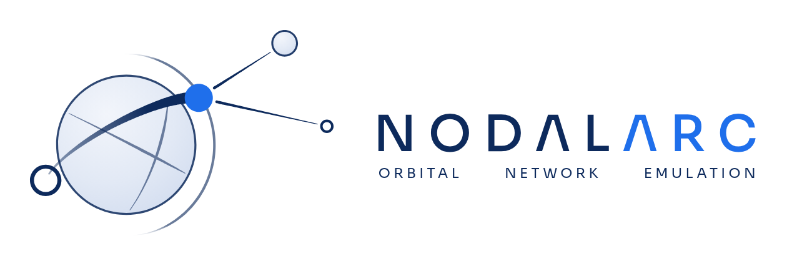
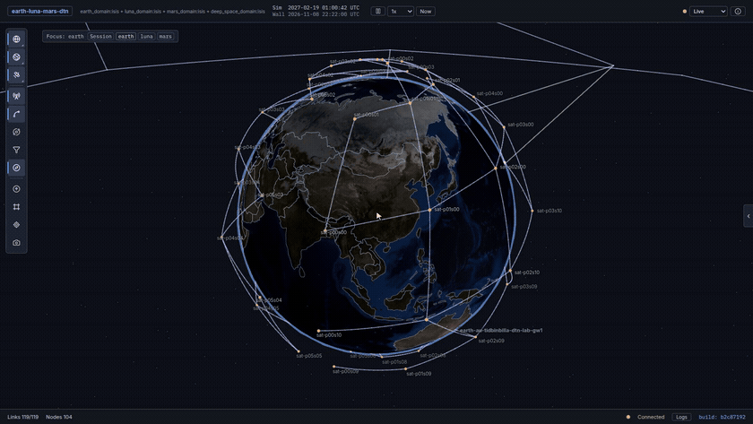
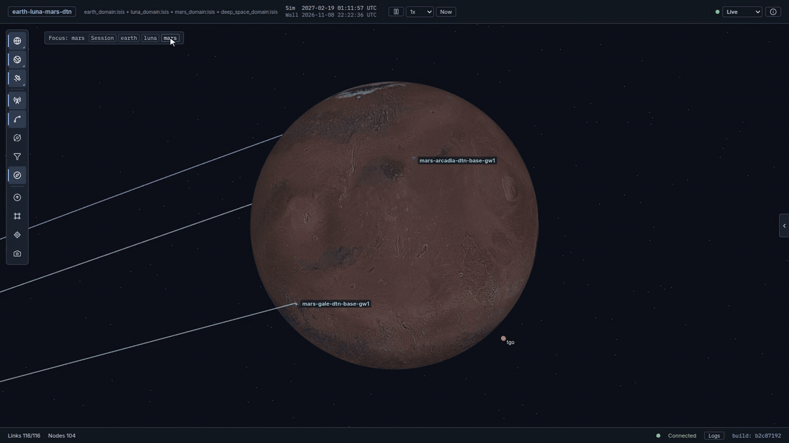
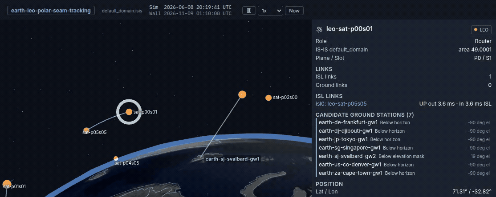
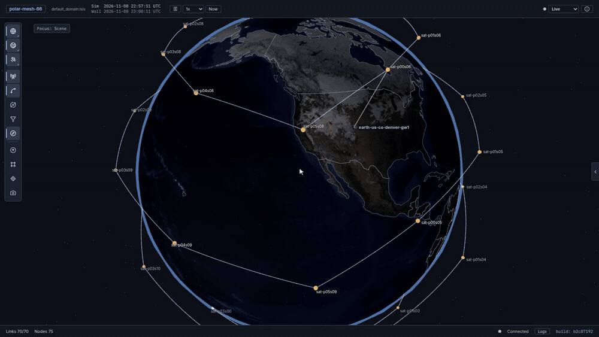
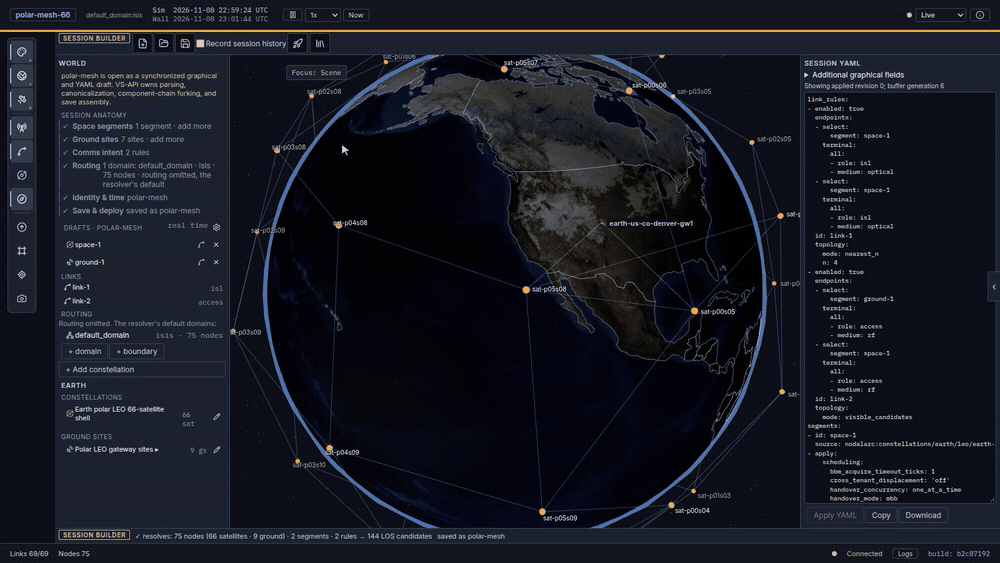

<h1>
  <picture>
    <source media="(prefers-color-scheme: dark)" srcset="docs/images/nodalarc-lockup-tagline-blue-mint-on-black.png">
    
  </picture>
</h1>

NodalArc is an emulator for space networks. It runs real routers and real protocol software inside a moving model of Earth orbit, the Moon and Mars, and you drive all of it from a web browser.



## What NodalArc Does

Every satellite, relay, ground station and surface base is a Linux container on a Kubernetes cluster. Every link between two of them is a real network link.

NodalArc moves each spacecraft along its orbit in real time, and the links follow the geometry. A link comes up when two terminals can see each other and are within range. It goes down when a planet blocks the view, when the range grows too long, or when a terminal reaches its tracking limit. Each link carries the light time of its current length: a few milliseconds to a satellite in low Earth orbit, 1.3 seconds to the Moon, and between 3 and 22 minutes to Mars. Each link also runs at the data rate of the terminal hardware you chose.

The software in the containers is the software you would fly. Routers run FRR and form real IS-IS and OSPF adjacencies. DTN nodes run NASA JPL's ION, NASA Glenn's HDTN and uD3TN. QUIC endpoints run picoquic. Every route and every delivered bundle comes from that software reacting to the moving network.

You describe each experiment as a session: the bodies, orbits, spacecraft, ground stations and links to emulate, and the software each node runs. A session is assembled from a catalog of reusable parts, in the browser or in YAML.

## Open a Terminal on Mars (or Anywhere)



Every node in a running session can be inspected and entered. Select a node and NodalArc shows its links, their light times and the candidates for its next link. Select a base on Mars and you see its coverage area and why it is linked to the areostationary relay. Select the relay and you see its crosslinks, the bases it serves and its optical trunk to the deep space relay at Earth, with 5.64 minutes of light time each way at the 2027 opposition.

Open a terminal on any router and you are in its CLI. On the Mars relay, `show isis neighbor` lists the Mars bases and the other orbiter, and a ping to the base at Gale crater comes back in 118 ms. A host gives you its own shell. You can also trace the path a packet takes between any two nodes, or switch to the topology view to see the same live network as a graph.

## Terminals and Handovers Work Like the Hardware



Every terminal model in the catalog carries the limits of the hardware it models:

- the directions it can point
- the angular rate it can track
- its maximum range
- its data rate in each direction

NodalArc checks both ends of every link against those limits as the spacecraft move. At the polar seam, satellites in counter-rotating planes pass each other faster than their terminals can track, and those links break. In the shipped polar seam tracking session, a seam crosslink goes down for 30 seconds while its two satellites pass within a few hundred kilometres of each other, then comes back as they separate.

A ground station hands over between satellites according to the scheduling its session declares:

- how it picks its next satellite: highest elevation, lowest elevation or longest remaining pass
- hysteresis, which keeps the current satellite until a candidate scores better by a set factor, with that preference fading as the current satellite sinks toward the elevation mask
- make-before-break or break-before-make handovers, with the overlap time and the terminals held in reserve
- the order in which competing stations claim a satellite's terminals

Select a ground station and NodalArc shows the decision behind each of its links: line of sight, range, elevation mask, tracking rate, selection policy, capacity, handover policy, and the proof from the Linux kernel that the link exists.

## What You Can Do With It

- Run IS-IS or OSPF over a LEO constellation and watch it reconverge each time a seam crosslink breaks.
- Measure what a ground station handoff costs your routing, in route changes and lost packets.
- Speed time up and watch hours of orbits go by in minutes, or pause it and read the routing tables.
- Send DTN bundles from a Mars base to a ground station on Earth through the Mars relays and an Earth relay, with the real light time on every hop.
- Put a QUIC client on Earth and a QUIC server on the Moon, and see how QUIC handles the 1.3 second light time.
- Change one thing, such as a terminal's data rate, an orbit's altitude, the number of planes or the location of a ground station, and compare the two runs.
- Script your experiments through the REST and WebSocket APIs.

## Why We Built It

Networks are leaving the ground. Thousands of satellites already carry traffic in low Earth orbit, and space agencies are planning networks around the Moon and Mars. The engineers who design routing for those networks need to see what their actual routers and protocol stacks do while the topology moves.

A satellite in low Earth orbit moves at about 7.5 km per second. It crosses a ground station's sky in a few minutes, and its links to neighbouring planes break and return as the planes cross. A ground station is the best exit on one pass and out of reach on the next. Farther out, a message to Mars spends minutes in flight, and Mars blocks a base's view of a low orbiter for most of each orbit.

We built NodalArc so that those conditions are real, repeatable and measurable, and so that every result can be traced to the protocol, the orbits or the hardware.

## Who It's For

- network engineers who design and run routing for satellite constellations
- researchers comparing routing, DTN and transport approaches on the same orbits, hardware and traffic
- people designing IP, transport and DTN protocols for the Moon, Mars and deep space
- anyone who wants to learn how networking behaves when the links underneath it keep changing

## Build Your Own Network



You build a session in the Session Builder in the browser:

1. Start a new session.
2. Open the Library and place a constellation, such as the 66-satellite polar shell, and a set of ground sites. The satellites and stations appear on the globe as you place them.
3. Connect them. Pick the satellites as both ends of one link rule for crosslinks between nearest neighbours, and pick the ground sites and the satellites for access links. The globe shows every candidate link, and the Builder resolves the session after every change: 75 nodes, 66 satellites, 9 ground stations, 144 candidate links.
4. Give the session a name and a candidate link budget, and save it.
5. Deploy it.



About thirty seconds after you deploy, the new network is running with a real router on every satellite and every ground station. Open a terminal on any satellite and its IS-IS neighbours are already up.

The Session Builder writes the same YAML file you could write by hand, and it shows that file beside the globe as you work. Each block you place is its own YAML file in the catalog, and the session refers to it. To change a block, fork it into your own catalog and edit your copy. Fork a terminal and double its data rate, and every link in your session that uses it runs at the new rate.

The shipped catalog holds these blocks:

- [bodies](catalog/nodalarc/bodies/): Earth, the Moon and Mars
- [orbits](catalog/nodalarc/orbits/): orbits around each body
- [constellations](catalog/nodalarc/constellations/): Walker, polar, ring, MEO and GEO layouts
- [space node sets](catalog/nodalarc/space-node-sets/): individually placed spacecraft, such as the Mars relays
- [nodes](catalog/nodalarc/nodes/): spacecraft and ground station models with their terminals and payloads
- [terminals](catalog/nodalarc/terminals/): RF and optical terminals with their range, data rate and tracking limits
- [sites](catalog/nodalarc/sites/) and [site sets](catalog/nodalarc/site-sets/): ground stations and surface bases at real locations
- [profiles](catalog/nodalarc/profiles/): the software each node runs
- [payloads](catalog/nodalarc/payloads/): hosts carried on a spacecraft or installed at a site
- [sessions](catalog/nodalarc/sessions/): complete experiments

## Example Sessions

NodalArc ships the sessions below as examples. Each one is a session file built from catalog blocks. Each one shows a different part of what you can model. Deploy any of them from the Sessions window to watch it run, or open one in the Session Builder to see how it is put together.

These sessions are a starting point. NodalArc is made for building your own sessions and modelling the networks you care about: a constellation flying today, a design still on paper, or a network at the Moon or Mars that nobody has built yet. Start from an example or from a blank session, change what you want to test, then deploy it and see what happens.

| Session | What it runs |
| --- | --- |
| [`earth-leo-simple`](catalog/nodalarc/sessions/earth-leo-simple.yaml) | A 36-satellite ring with gateway ground stations |
| [`earth-leo-walker`](catalog/nodalarc/sessions/earth-leo-walker.yaml) | A 176-satellite Walker-delta shell with gateway access |
| [`earth-leo-polar`](catalog/nodalarc/sessions/earth-leo-polar.yaml), [`earth-leo-polar-seam`](catalog/nodalarc/sessions/earth-leo-polar-seam.yaml), [`earth-leo-polar-seam-tracking`](catalog/nodalarc/sessions/earth-leo-polar-seam-tracking.yaml) | Polar shells, the seam where counter-rotating planes pass each other, and links that break at a terminal's tracking limit |
| [`earth-meo-gps`](catalog/nodalarc/sessions/earth-meo-gps.yaml), [`earth-geo-tdrs`](catalog/nodalarc/sessions/earth-geo-tdrs.yaml), [`earth-geo-inmarsat`](catalog/nodalarc/sessions/earth-geo-inmarsat.yaml) | MEO and GEO constellations with their gateway sites |
| [`earth-leo-heo-geo-luna-reachability`](catalog/nodalarc/sessions/earth-leo-heo-geo-luna-reachability.yaml) | Two LEO constellations, HEO and GEO relays, lunar relays and lunar surface nodes in one routed network |
| [`earth-luna-quic`](catalog/nodalarc/sessions/earth-luna-quic.yaml) | A QUIC client on Earth and a QUIC server on the Moon |
| [`earth-luna-dtn`](catalog/nodalarc/sessions/earth-luna-dtn.yaml), [`earth-luna-dtn-custody`](catalog/nodalarc/sessions/earth-luna-dtn-custody.yaml) | A DTN relay at the Moon that stores bundles while its next hop is out of sight |
| [`earth-mars-hdtn-relay`](catalog/nodalarc/sessions/earth-mars-hdtn-relay.yaml) | Three Mars bases reaching Earth through Mars relays and an optical trunk, running HDTN |
| [`mars-ion-relay-network`](catalog/nodalarc/sessions/mars-ion-relay-network.yaml) | The Mars relay network on its own, running ION with contact graph routing |
| [`earth-luna-mars-dtn`](catalog/nodalarc/sessions/earth-luna-mars-dtn.yaml) | Earth, the Moon and Mars in one session |

## Run Any Software On Any Node

FRR is the router NodalArc ships with, running IS-IS, OSPF and static routing over IPv4 and IPv6, with SR-MPLS, LDP and traffic engineering. NodalArc is designed to run router containers from Cisco, Arista, Juniper and other vendors, a container you build yourself, or a plain Linux host, on any node and in any mix. A workload profile names the container image and how to start it, and NodalArc connects that container's interfaces to the moving network. The DTN and QUIC example sessions already run their software this way.

## Where NodalArc Is Going

The session grammar already describes more than the runtime runs today, and the runtime adds those parts one at a time. Next on the list:

- Lagrange points, with relays held in orbit around them by three-body motion
- BGP routing domains, which the grammar already defines
- more bodies, starting with Venus
- rovers and other nodes that move across a body's surface

## How It Works

```text
OME          Computes orbits, visibility, range and ground station handoffs
Scheduler    Decides which links should exist and keeps the kernel in line with that
Node Agent   Builds the links in the Linux kernel and proves they exist
Operator     Runs the session's pods and delivers their configuration
VS-API       Serves the browser, the REST API and the WebSocket API
VF           The browser interface: globe, topology view, terminals, Session Builder
NATS         Carries events between the services
```

Links between nodes are veth pairs on one server and VXLAN tunnels between servers. `tc` applies each link's delay and data rate. NodalArc measures the delay that the lab network itself adds and subtracts it, so a session spread across several servers keeps the delay that the orbits call for.

A session spreads its nodes across every server in the cluster. [Scaling and Performance](docs/ops/scaling.md) has measured numbers and a sizing formula.

## Get Started

NodalArc runs entirely in containers on Kubernetes: the platform services, a Node Agent on every server, and one container for every node in a session. The command line is for installing and operating the platform. Once it is running, you work in the browser or through the API.

### Requirements

- A Kubernetes cluster whose nodes admit privileged pods, or Ubuntu or Debian machines to build one on
- Host kernel support for network namespaces, veth, VXLAN, `tc` and, for MPLS sessions, the MPLS modules; the Node Agent reports what a node lacks
- 8 GB RAM for the 36-satellite default session and 32 GB for larger sessions; a session with an Earth-Mars link needs about 9.6 GiB of allocatable memory on the server that holds both ends of that link
- On a cluster of several servers, a network between them that carries the emulated link MTU plus the VXLAN overhead: 8,850-byte packets at the default 8,800-byte link MTU

### For Users

NodalArc is published as container images and a Helm chart. You install it on a Kubernetes cluster with Helm, and nothing is built. On the machine you work from, you need [kubectl](https://kubernetes.io/docs/tasks/tools/) and [Helm](https://helm.sh/docs/intro/install/).

Pick the release you install, the newest on the [Releases](https://github.com/dotchance/nodalarc/releases) page:

```bash
RELEASE=0.8.1
```

If you have no Kubernetes cluster yet, the release carries two scripts that build K3s for NodalArc on Ubuntu or Debian machines. Each lists the changes it will make and asks before applying them.

```bash
curl -fsSLO https://github.com/dotchance/nodalarc/releases/download/$RELEASE/build-k3s-cluster.sh
curl -fsSLO https://github.com/dotchance/nodalarc/releases/download/$RELEASE/build-k3s-node.sh
chmod +x build-k3s-cluster.sh build-k3s-node.sh

# NodalArc on one machine: run this on that machine
sudo ./build-k3s-node.sh
export KUBECONFIG=/etc/rancher/k3s/k3s.yaml

# or on several servers: run this on your own machine, naming each server's ssh
# address, the first one first; it writes the cluster's kubeconfig for you
./build-k3s-cluster.sh --published-images <first server> <server> ...
export KUBECONFIG=~/.kube/nodalarc.yaml
```

`build-k3s-cluster.sh` builds every server over ssh. It runs unattended when your machine logs in to each server with an ssh key and sudo there needs no password; otherwise it asks for each password, under an INPUT NEEDED notice, and waits for you.

Install NodalArc and check it:

```bash
helm install nodalarc oci://ghcr.io/dotchance/nodalarc --version $RELEASE \
  --namespace nodalarc --create-namespace --wait
helm test nodalarc -n nodalarc --logs
```

When the install finishes, Helm prints where the browser interface is: port 3000 on the server that runs VS-API. Open it and deploy a session from the Sessions window.

`helm uninstall nodalarc -n nodalarc` removes the session, the platform and NodalArc's network devices on every server. `kubectl delete namespace nodalarc` and `kubectl delete crd constellationspecs.nodalarc.io` then remove the saved session data and the ConstellationSpec definition.

### For Developers

Developers build NodalArc from a source checkout and run it on their own cluster; the [Developer Guide](docs/dev/getting-started.md) has more on each step. The build machine needs git to clone the repository (`sudo apt-get install git` on Ubuntu or Debian). `scripts/bootstrap-dev-machine.sh` installs the build tools (make, Docker, kubectl, Helm, uv and crane) on the build machine; skip it if they are installed. When it adds your account to the docker group, it says so: log out and back in before the next step so your account can use Docker. Then build K3s on this machine, or a cluster of several servers from it:

```bash
git clone https://github.com/dotchance/nodalarc.git
cd nodalarc
sudo scripts/bootstrap-dev-machine.sh

# NodalArc on this machine alone:
sudo scripts/build-k3s-node.sh
# or on a cluster: every server's ssh address, the first one first
scripts/build-k3s-cluster.sh <first server> <server> ...

make all
```

`build-k3s-cluster.sh` without `--published-images` also runs an image registry on the first server and connects the build machine to it: the kubeconfig in `~/.kube/nodalarc.yaml`, `KUBECONFIG` and `REGISTRY_HOST` in `config.mk`, and the registry in Docker's `insecure-registries`.

`make all` installs the Python dependencies the build uses, builds the images, imports them into K3s or pushes them to the registry, installs the Helm chart, deploys the default session and prints the status. When the platform is ready, open the Visualization address that `make all` prints at its end (`make status` prints it again). On a single machine it is:

```text
http://localhost:3000
```

## Documentation

- [User Guide](docs/user/): the globe and topology views, sessions, time controls, terminals and the API
- [Operations Guide](docs/ops/): installation, multi-server clusters, [scaling](docs/ops/scaling.md), teardown and troubleshooting; the install steps for the published runtime containers will live here
- [Developer Guide](docs/dev/): building from source, architecture, invariants, services, tests and the contribution workflow

## Community

NodalArc is open source under the GNU Affero General Public License, version 3 only. Bug reports, routing stacks, constellation models, interface improvements, documentation fixes and reports from your own experiments are all welcome.

- **Issues**: bug reports, feature requests and questions
- **Pull Requests**: read [CONTRIBUTING.md](CONTRIBUTING.md), the [Developer Guide](docs/dev/) and the [Contributor License Agreement](CLA.md) before opening one
- **Discussions**: architecture proposals, use cases and experiments

## License

NodalArc is licensed under the GNU Affero General Public License, version 3 only (AGPL-3.0-only). See [LICENSE](LICENSE) for the full terms. [NOTICE](NOTICE) holds additional terms under Section 7 of that License, which the SPDX identifier does not name. A modified version carries "Based on NodalArc by .chance (dotchance), https://github.com/dotchance/nodalarc" in its documentation and in its interface's legal notices, must not be presented as the original or use "NodalArc" as its product name, and gets no right to the NodalArc name or the author's name for endorsement. NOTICE also grants an additional permission: the programs NodalArc runs on emulated nodes stay under their own licenses. The catalog files, and the YAML examples in this README and under `docs/`, are licensed under AGPL-3.0-only OR CC0-1.0, so experiment files built from them can carry no AGPL obligations. [THIRD_PARTY_NOTICES.md](THIRD_PARTY_NOTICES.md) lists bundled third-party notices.

Copyright 2024-2026 .chance (dotchance)
