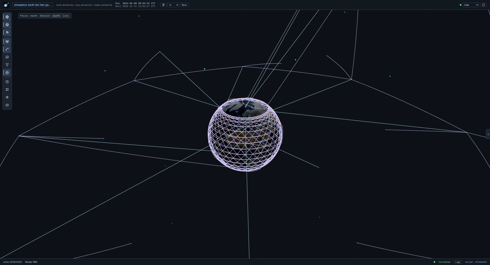
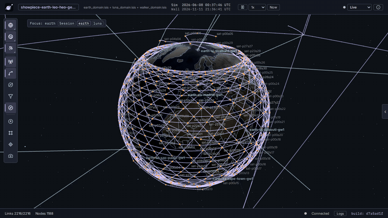

# Scaling and Performance



NodalArc scales with the cluster it runs on. Every node in a session is a real router in its own container, and NodalArc spreads those containers across every server in the cluster. On 11 November 2026, one session on four servers ran 1,413 FRR routers: a 1,408-satellite Walker-delta constellation and five ground gateways, joined by 2,829 links that orbital mechanics brought up and down as the satellites moved.

## +1400 nodes, no problem

Every satellite in that session ran FRR with IS-IS over four optical inter-satellite links and a Ka-band ground terminal. Here is what the run showed:

- **One converged network.** All 1,413 routers converged into one IS-IS network. The gateway in Denver held a route to every other router in the session.
- **Clean paths across the sky.** Pings from the Denver and Ashburn gateways to a satellite on the far side of the constellation came back with no loss. From Denver the path crossed 22 hops, with a round trip of about 170 ms.
- **Live handovers.** Ground handovers ran throughout, and IS-IS recomputed its routes after each one.
- **Physics in real time.** OME computed the orbits, visibility and link delays for every one-second step in under half a second (468 ms at the 95th percentile), and simulated time kept pace with real time.
- **Fast start.** The session went from upload to Ready in under four minutes. The Operator created 1,413 pods in about 10 seconds, the Node Agents wired every interface in about 70 seconds, and the Scheduler brought up 2,828 links in two and a half minutes.

| Session | Routers | Links | Servers | Upload to Ready |
|---|---|---|---|---|
| 704-satellite Walker-delta constellation and 5 gateways | 709 | 1,417 | 4 | 88 seconds |
| 1,408-satellite Walker-delta constellation and 5 gateways | 1,413 | 2,829 | 4 | 3.6 minutes |
| Earth-Moon session with LEO, MEO, HEO and GEO satellites, Moon relays and a 1,056-satellite Walker-delta constellation | 1,188 | 2,219 | 4 | 175 seconds |

## Many Orbits, Two Bodies, One Session

The session in these pictures adds a 1,056-satellite Walker-delta constellation to the shipped Earth-Moon session, which carries satellites in LEO, MEO, HEO and GEO, relays around the Moon and ground sites on both bodies. That is 1,188 routers on the same four servers. It reached Ready 175 seconds after upload, OME computed each step in 180 ms at the 95th percentile, and every router in the constellation held a route to every other one.



## The Cluster

The four servers each have a 14-core Intel Core i9-13900HK, 32 GB of memory, NVMe storage and 1 Gb/s Ethernet. The release's `build-k3s-cluster.sh` built K3s on them, and NodalArc 0.8.1 was installed from the published chart with its default values. The satellites are the shipped `starlink-v2-mesh` model at 550 km and 53 degrees, linked to their neighbours in the same plane and in the two adjacent planes. The sessions declared an IS-IS domain with per-plane areas and timers chosen for their size.

## Where the Capacity Goes

**Memory.** A satellite router used about 35 MiB of server memory in the 704-satellite session and about 60 MiB in the 1,408-satellite session, because each router's IS-IS database holds the whole network. A 32 GB server carries about 350 routers of a 1,400-router session, and more of a smaller one. The platform services use about 2 GiB in the cluster, and the Node Agent about 0.4 GiB on each server.

**CPU.** A router at rest uses about 15 millicores. The servers ran at 18% to 24% CPU with 704 satellites and 54% to 73% with 1,408, where every ground handover reaches all 1,413 routers.

**Network and storage.** Traffic between servers peaked at 408 Mb/s on 1 Gb/s links, and disk writes peaked at about 50 MB/s while the pods started. Each server held up to 355 session pods.

**More servers, more routers.** Each server runs its own Node Agent, its own share of the session's pods and its own VXLAN tunnels to the other servers. Packets travel through the servers' kernels from router to router, and no central service sits in the data path. A larger cluster holds a larger session.

## How to Measure

```bash
# Server CPU and memory
kubectl top nodes

# Session pods per server
kubectl -n nodalarc get pods -l nodalarc.io/session=true -o wide --no-headers | awk '{print $7}' | sort | uniq -c

# OME step time: one line a minute with the median, 95th percentile and overruns
kubectl -n nodalarc logs deploy/ome | grep "OME pacing" | tail -1

# Pacing, session status and link count through the API
VS_API=$(kubectl -n nodalarc get pod -l app=nodalarc-vs-api -o jsonpath='{.items[0].status.hostIP}'):8080
TOKEN=$(curl -s http://$VS_API/api/v1/auth/token | python3 -c "import json,sys; print(json.load(sys.stdin)['token'])")
curl -s -H "Authorization: Bearer $TOKEN" http://$VS_API/api/v1/state | \
  python3 -c "import json,sys; d=json.load(sys.stdin); print(d['session_status'], d['playback_achieved'], len(d['links']), 'links')"

# IS-IS on one router: SPF runs and their duration
kubectl -n nodalarc exec <pod> -c frr-router -- vtysh -c "show isis summary"
```
